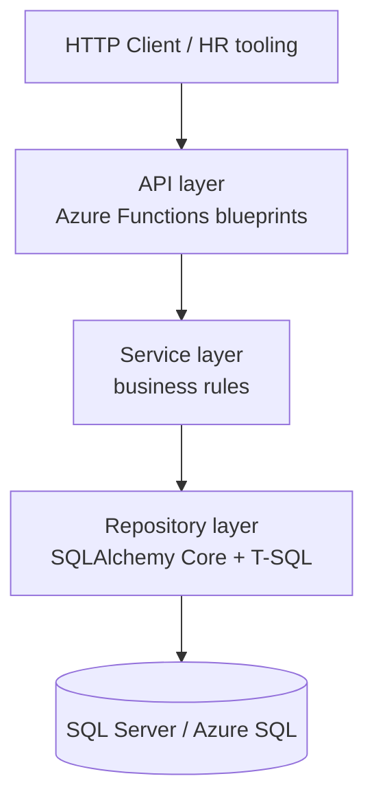
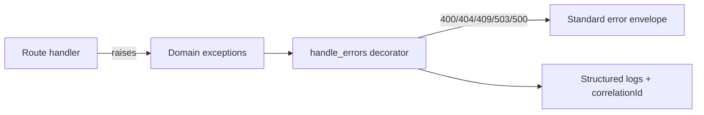

# Architecture

## Layered design

| Layer | Responsibility | Location |
|-------|----------------|----------|
| API | Routing, parsing, status codes, error envelope | `src/ecs/api/` |
| Service | FK checks, delete guards, default-bonus policy, B6 comparison | `src/ecs/services/` |
| Repository | Parameterized CRUD + reporting SQL | `src/ecs/repositories/` |
| Domain / schemas | Internal types vs wire contracts | `src/ecs/domain/`, `src/ecs/schemas/` |
| Core | Config, DB engine, exceptions, logging, secrets audit | `src/ecs/core/` |

Dependency rule: **inward only**. Repositories never import API types. Domain has no framework dependencies.

## Composition root

`src/ecs/function_app.py` builds one SQLAlchemy `Engine` per process, constructs repositories and services, initializes blueprints, and registers them on the `FunctionApp`. Root `function_app.py` re-exports `app` for the Functions host.

## Error flow

## Reporting SQL

CRUD uses SQLAlchemy Core expression builders. Part B reports use **hand-written parameterized T-SQL** (`sqlalchemy.text`) so `HAVING`, `RANK()`, and explicit NULL ordering remain inspectable and testable.
